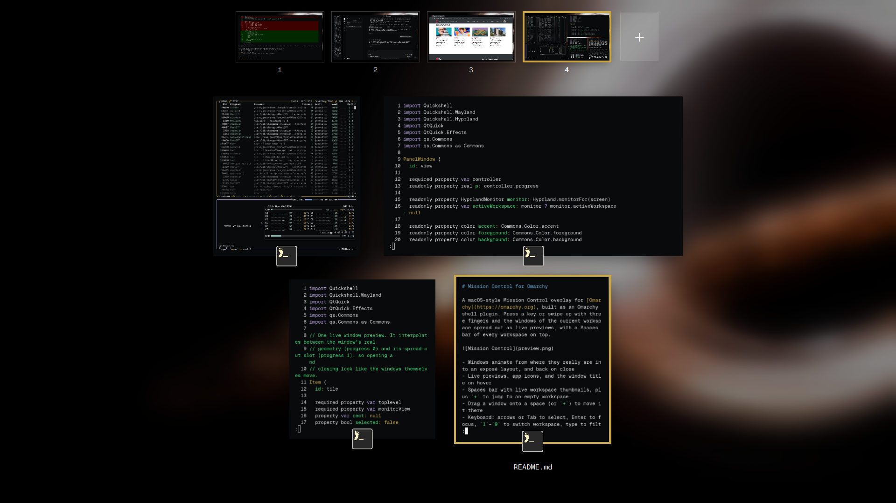

# Mission Control for Omarchy

A macOS-style Mission Control overlay for [Omarchy](https://omarchy.org), built as an Omarchy shell plugin. Press a key or swipe up with three fingers and the windows of the current workspace spread out as live previews, with a Spaces bar of every workspace on top.



- Windows animate from where they really are into an exposé layout, and back on close
- Live previews, app icons, and the window title on hover
- Spaces bar with live workspace thumbnails, plus `+` to jump to an empty workspace
- Drag a window onto a space (or `+`) to move it there
- Keyboard: arrows or Tab to select, Enter to focus, `1`–`9` to switch workspace, type to filter windows by title or class, Esc to close
- Middle-click or the hover `✕` closes a window
- Follows the current Omarchy theme (colors, font, corner rounding) over a blurred copy of the current background
- One view per monitor, each showing that monitor's active workspace
- Event-driven: nothing runs while it is closed

## Install

```bash
omarchy plugin add https://github.com/joaovitor2763/omarchy-mission-control.git --enable
```

Plugins can't register keybindings, so add these yourself. In `~/.config/hypr/bindings.lua`:

```lua
o.bind("SUPER + GRAVE", "Mission Control", "omarchy-shell shell toggle io.github.joaovitor2763.mission-control '{}'")
hl.layer_rule({ match = { namespace = "omarchy-mission-control" }, no_anim = true, animation = "none" })
```

For the macOS gesture, in `~/.config/hypr/input.lua`:

```lua
hl.gesture({ fingers = 3, direction = "up", action = function() hl.exec_cmd("omarchy-shell shell summon io.github.joaovitor2763.mission-control '{}'") end })
hl.gesture({ fingers = 3, direction = "down", action = function() hl.exec_cmd("omarchy-shell shell hide io.github.joaovitor2763.mission-control") end })
```

Omarchy's three-finger horizontal swipe already changes workspace, so vertical swipes are free.

## Update

```bash
omarchy plugin update io.github.joaovitor2763.mission-control
omarchy-restart-shell
```

The shell caches plugin QML, so restart it to load the new version. See the [changelog](CHANGELOG.md) for what changed.

## Remove

```bash
omarchy plugin remove io.github.joaovitor2763.mission-control
```

Then delete the binding, layer rule, and gesture lines you added to `bindings.lua` and `input.lua`.

## Requirements

A current Omarchy release (Lua Hyprland config and the Quickshell-based `omarchy-shell`). No external dependencies.

## License

[MIT](LICENSE)
